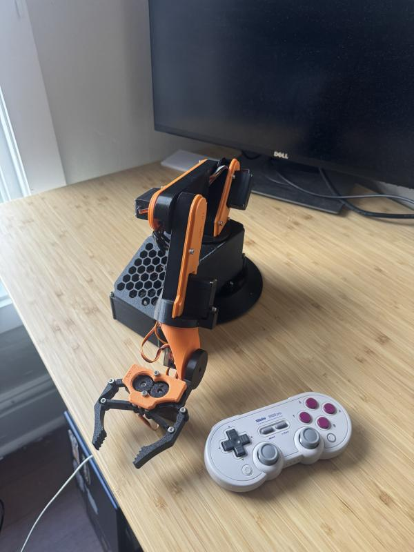

# RobotArm

A 5-DOF robotic arm with gripper, controlled wirelessly over Bluetooth from an 8BitDo SN30 Pro game controller. An ESP32 running [Bluepad32](https://github.com/ricardoquesada/bluepad32) receives controller input and drives six servos through a PCA9685 PWM driver using rate-based control.

## Overview

The arm uses four MG996R servos for the main joints and two MG90S servos for the wrist and gripper. Each joint is mapped to a controller input, analog sticks drive the main joints with rate control (stick deflection sets speed), and the shoulder buttons and triggers drive the wrist and gripper. Input is smoothed with an exponential moving average to reduce servo jitter, and each channel has tunable pulse-width bounds.

## Hardware

| Component | Detail |
|-----------|--------|
| Microcontroller | ESP32 (ESP32-WROOM-32) |
| Servo driver | PCA9685 16-channel PWM driver (I²C) |
| Main joint servos | 4 × MG996R (metal-gear) |
| Wrist / gripper servos | 2 × MG90S |
| Controller | 8BitDo SN30 Pro (Bluetooth) |
| Power | 6 V DC supply to PCA9685 V+ (servos); ESP32 powered via USB |
| Structure | 3D-printed |

## Control Mapping

| Input | Channel | Joint |
|-------|---------|-------|
| Right stick X | 0 | Base rotation |
| Right stick Y | 1 | Shoulder |
| Left stick Y | 2 | Elbow |
| Left stick X | 3 | Wrist |
| R1 / L1 | 4 | Wrist rotation |
| R2 / L2 | 5 | Gripper |

## Wiring

- `ESP32 3V3` → `PCA9685 VCC` (logic power, 3.3 V)
- `ESP32 GND` → `PCA9685 GND` (common ground)
- `ESP32 D21` → `PCA9685 SDA`
- `ESP32 D22` → `PCA9685 SCL`
- `6V supply` → `PCA9685 V+ / V−` (servo power only)

**Note:** The 6 V supply connects only to the V+/V− screw terminals. VCC takes 3.3 V from the ESP32 — never the 6 V rail.

## Setup

1. Install the **esp32_bluepad32** board package in the Arduino IDE (add the [Bluepad32 boards URL](https://github.com/ricardoquesada/bluepad32) under Additional Boards Manager URLs).
2. Install the **Adafruit PWM Servo Driver** library.
3. Select the board under the **esp32_bluepad32** group and flash the sketch.
4. Power on the SN30 Pro in Android mode (hold **B + Start**), then hold the pair button until the LED rotates.
5. The ESP32 connects automatically; move the sticks to drive the arm.

## Tuning

- `SERVOMIN` / `SERVOMAX` — pulse-width bounds per servo type (MG996R and MG90S have separate values).
- `DIV` — joint speed (smaller = faster).
- `DEADZONE` — stick center tolerance.
- Flip a joint's direction by negating its term (`+` ↔ `-`).

## License

MIT

